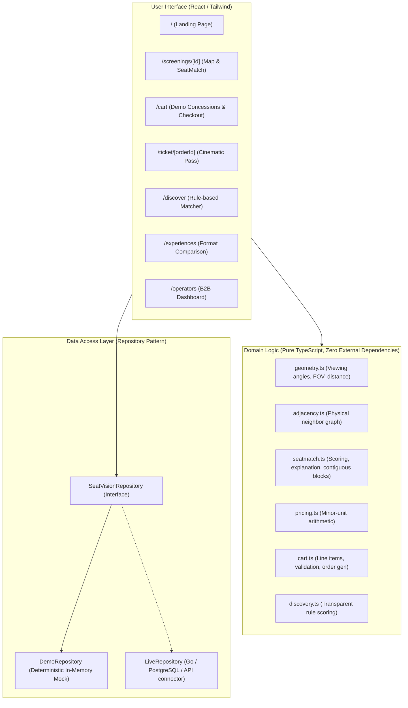

# SeatVision — Technical Architecture

## 1. System Overview

SeatVision is built as a modular Next.js application (App Router, React 19, TypeScript strict mode) designed to separate presentation, pure domain calculation, and data access.

## 2. Key Architectural Guarantees

1. **Separation of Auditorium, Availability, and Pricing:**
   - Physical layout coordinates (`Auditorium`) do not change between screenings.
   - Live availability snapshots (`ScreeningAvailability`) are screening-specific.
   - Pricing by category (`ScreeningPricing`) is screening-specific.

2. **Explicit Physical Adjacency vs. Seat Labels:**
   - Adjacency is modeled as a directed link `rightNeighborId: string | null`.
   - Aisles, gaps, staggered rows, and recliner pairings break adjacency even when seat numbers are sequential (e.g. `F4` next to aisle, `F5` across aisle are NOT adjacent).
   - Seat labels are display strings only and never used to infer connectivity.

3. **Data Provenance & Honesty:**
   - Every entity carries `provenance: { source: 'demo' | 'verified-static' | 'live' }`.
   - Missing data (unsupplied screen sizes, unmeasured distances, unverified premium categories) is treated explicitly: confidence is lowered and limitations are listed. Missing information is never fabricated.

4. **Pure Domain Testing:**
   - All critical calculations (adjacency graph validation, SeatMatch score weighting, price sums, order state creation) reside in standalone, pure functions tested via Vitest with 100% deterministic test fixtures.
